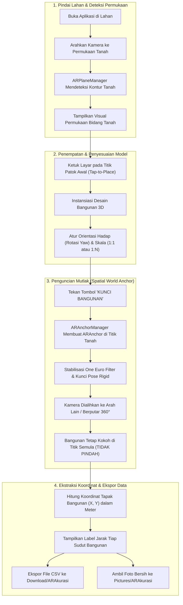

# Product Requirements Document (PRD)
## Proyek: AR-SitePlan - Sistem Proyeksi Desain Bangunan di Lahan & Penguncian Spasial Berbasis AR

---

## 1. Informasi Dokumen & Metadata

* **Nama Produk:** AR-SitePlan (Sistem Proyeksi Desain Bangunan & Pengukuran Koordinat Lahan AR)
* **Versi Dokumen:** 2.0.0
* **Tanggal Pembaruan:** 13 November 2026
* **Penulis / Tim Pengembang:** Tim Riset / Proyek AR Universitas Diponegoro (UNDIP)
* **Status Produk:** Engineering & Implementation Ready
* **Target Platform:** Android (Google ARCore, ARM64, Min SDK API 24) & Unity Editor (XR Simulation)
* **Engine & Framework:** Unity 6 (6000.x), Universal Render Pipeline (URP 17.0), Unity AR Foundation 6.5 (ARCore Plugin)

---

## 2. Ringkasan Eksekutif & Latar Belakang (Executive Summary)

### 2.1. Latar Belakang
Dalam industri arsitektur, teknik sipil, dan konstruksi, memvisualisasikan rancangan bangunan 3D langsung di atas lahan kosong (*on-site visualization*) sebelum pembangunan dimulai adalah tantangan besar. Metode konvensional mengandalkan patok fisik dan pembacaan denah kertas 2D yang memakan waktu dan rentan salah interpretasi. 

Dengan teknologi Augmented Reality (AR) berbasis **Google ARCore** dan **Spatial Anchoring**, rancangan bangunan 3D dapat diproyeksikan langsung di atas permukaan tanah nyata pada skala sebenarnya (1:1), dikunci secara absolut di dunia fisik, serta dihitung titik-titik koordinat tapak bangunannya $(X, Y)$ secara presisi.

### 2.2. Pernyataan Masalah (*Problem Statement*)
1. **Pergeseran Objek Saat Kamera Dialihkan (*Tracking Drift / Occlusion*)**: Banyak aplikasi AR sederhana kehilangan posisi objek ketika kamera pengguna menoleh ke arah lain di lahan atau ketika pengguna berjalan menjauh. Dibutuhkan mekanisme **Spatial World Anchoring (`ARAnchor`)** agar model bangunan tetap terkunci di titik tanah yang sama tanpa bergeser.
2. **Kebutuhan Pengukuran Titik Tapak Lahan $(X, Y)$**: Pengguna di lapangan (mandor, arsitek, atau surveyor) membutuhkan ekstraksi koordinat numerik dari titik-titik sudut bangunan (misal: 4 sudut tapak pondasi) dalam satuan meter dari patok batas lahan.
3. **Fluktuasi Getaran Objek (*Jitter*) pada Skala Besar**: Model bangunan berskala besar ($10\text{ m} \times 20\text{ m}$) rentan terlihat berguncang di layar akibat *sensor noise* ponsel. Diperlukan stabilisasi filter *One Euro* untuk menjaga visual tetap kokoh.

### 2.3. Tujuan Produk (*Product Goals*)
1. **Proyeksi Desain Bangunan di Lahan Fisik**: Memproyeksikan model 3D bangunan ke atas permukaan tanah nyata menggunakan deteksi bidang horizontal (*Ground Plane Detection*).
2. **Penguncian Posisi Mutlak (*Persistent Spatial Lock*)**: Begitu tombol "Kunci Bangunan" ditekan, sistem menambatkan model ke **`ARAnchor`** dunia nyata. Pengguna dapat mengalihkan kamera 360°, berjalan mengelilingi lahan, atau mengarahkan kamera ke langit; saat kamera diarahkan kembali ke lahan, **bangunan tetap berada persis di posisi semula**.
3. **Ekstraksi Koordinat $(X, Y)$ Tapak Bangunan**: Menghitung koordinat kartesian 2D $(X_i, Y_i)$ dari setiap sudut bangunan dalam satuan **meter (m)** terhadap patok titik nol lahan.
4. **Skala Fleksibel**: Menyediakan opsi skala 1:1 (ukuran asli lapangan) serta skala pratinjau maket (1:10 s.d. 1:100).
5. **Ekspor Data Lapangan**: Menyimpan titik koordinat tapak bangunan ke dalam file CSV dan dokumentasi foto berparameter (*clean screenshot*) langsung ke folder perangkat `Download/ARAkurasi/`.

---

## 3. Persona Pengguna & Kasus Penggunaan (User Personas & Use Cases)

### 3.1. Persona Pengguna
* **Surveyor Lahan / Site Engineer**: Menginspeksi apakah batas-batas tapak bangunan sesuai dengan sertifikat tanah dan batas kavling fisik.
* **Arsitek / Klien Pemilik Properti**: Memvisualisasikan orientasi sinar matahari, arah angin, serta tata letak bangunan terhadap lingkungan sekitar lahan secara nyata.
* **Mahasiswa / Peneliti Teknik**: Mengukur akurasi *world tracking* dan deviasi koordinat spasial ARCore pada kondisi lingkungan terbuka (*outdoor*).

### 3.2. Kasus Penggunaan Utama (*Core Use Cases*)

```text
UC-01: Deteksi Permukaan Tanah (Ground Plane Detection)
  Pengguna memindai permukaan tanah lahan dengan kamera ponsel hingga kisi-kisi bidang terdeteksi.

UC-02: Penempatan Desain Bangunan (Tap-to-Place Model)
  Pengguna mengetuk layar pada permukaan tanah untuk memunculkan model 3D desain bangunan.

UC-03: Penguncian Spasial Bangunan (Spatial Lock)
  Pengguna menekan tombol "Kunci Bangunan". Sistem mengikat transformasi bangunan ke ARAnchor fisik.
  Kamera dialihkan ke arah lain, lalu diarahkan kembali: bangunan TIDAK PINDAH TEMPAT.

UC-04: Ekstraksi Titik Koordinat (X, Y)
  Sistem mengekstrak koordinat sudut-sudut tapak pondasi bangunan dalam satuan meter (m) terhadap patok titik nol.

UC-05: Ekspor Laporan CSV & Tangkapan Layar
  Pengguna mengekspor data koordinat ke file CSV dan memotret dokumentasi visual tanpa UI ke galeri HP.
```

---

## 4. Arsitektur Produk & Alur Kerja Lapangan (Workflow)



---

## 5. Spesifikasi Kebutuhan Fungsional (Functional Requirements)

### FR-01: Deteksi Permukaan Tanah Lahan (*Ground Plane Detection*)
* **Deskripsi:** Sistem harus mampu mendeteksi bidang datar tanah/lahan secara *real-time* menggunakan subsistem `ARPlaneManager` dan `ARRaycastManager`.
* **Kriteria Penerimaan:**
  1. Mendeteksi bidang permukaan tanah horizontal (*Horizontal Ground Plane*).
  2. Menampilkan visualisasi kisi-kisi permukaan bidang tanah tipis (*feathered plane visualizer*) sebagai panduan bagi pengguna.

### FR-02: Penempatan Model Bangunan (*Tap-to-Place Model*)
* **Deskripsi:** Pengguna dapat menempatkan model 3D desain bangunan di atas permukaan tanah yang terdeteksi dengan mengetuk layar ponsel.
* **Kriteria Penerimaan:**
  1. Sistem melakukan *raycast* dari titik sentuhan layar ke bidang tanah fisik (`ARRaycastManager.Raycast`).
  2. Model bangunan 3D diinstansiasi tepat pada titik potong sinar terhadap bidang tanah.
  3. Menyediakan kontrol rotasi yaw (0°–360°) untuk mencocokkan arah hadap bangunan terhadap jalan atau mata angin.

### FR-03: Penguncian Spasial Absolut (*Persistent Spatial Lock*)
* **Deskripsi:** Fitur utama untuk mengunci model bangunan secara mutlak di koordinat dunia fisik menggunakan **`ARAnchorManager`**.
* **Kriteria Penerimaan:**
  1. Saat tombol **"KUNCI BANGUNAN"** ditekan:
     * Sistem membuat komponen **`ARAnchor`** pada posisi dan rotasi persis di titik tanah tersebut.
     * GameObject bangunan di-parent ke `ARAnchor`.
  2. **Uji Kestabilan (Paling Kritis):**
     * Saat pengguna mengalihkan kamera ponsel ke arah lain (misal: menoleh 180° membelakangi lokasi bangunan, menengadah ke langit, atau berjalan 20 meter menjauh).
     * Saat kamera diarahkan kembali ke titik semula: **Model bangunan 3D tetap berada persis di tempatnya tanpa bergeser sedikit pun**.
  3. Menerapkan *One Euro Filter* untuk meredam osilasi getaran (*jitter*) sensor kamera pada skala besar.

### FR-04: Ekstraksi Koordinat Tapak Bangunan $(X, Y)$ dalam Satuan Meter
* **Deskripsi:** Sistem harus menghitung koordinat kartesian 2D $(X_i, Y_i)$ dari setiap titik sudut batas bangunan di atas permukaan lahan.
* **Kriteria Penerimaan:**
  1. Titik patok referensi awal (misal sudut kiri-bawah bangunan) ditetapkan sebagai **Titik Nol $(0.00, 0.00)\text{ m}$**.
  2. Titik-titik sudut lainnya (misal 4 sudut pondasi) dihitung relatif terhadap titik nol dalam satuan **meter (m)**:
     $$X_i = (P_{i, x} - P_{0, x}), \quad Y_i = (P_{i, z} - P_{0, z})$$
  3. Menampilkan label teks koordinat mengambang (*billboard labels*) di atas setiap sudut bangunan pada layar kamera.

### FR-05: Skala Lapangan Fleksibel (1:1 s.d. 1:100)
* **Deskripsi:** Mendukung visualisasi pada ukuran asli (1:1) dan ukuran maket/pratinjau.
* **Kriteria Penerimaan:**
  1. **Mode 1:1 (Real-Scale)**: Ukuran model 1 meter di Unity sama persis dengan 1 meter di lahan fisik nyata.
  2. **Mode Maket (1:10, 1:20, 1:50, 1:100)**: Memungkinkan pengguna melihat keseluruhan bentuk bangunan secara ringkas di atas area lahan yang lebih kecil.

### FR-06: Manajemen Tampilan Visual Model Bangunan
* **Deskripsi:** Pengguna dapat mengubah material bangunan untuk melihat detail struktur atau situasi di balik dinding virtual.
* **Mode Tampilan:**
  1. **Solid**: Menampilkan dinding, atap, dan tekstur bangunan realistis.
  2. **Transparan**: Mengubah bangunan menjadi transparan dengan slider opasitas (5% s.d. 100%) agar kontur tanah asli di dalam area tapak bangunan tetap terlihat.
  3. **Wireframe / Garis Denah**: Hanya menampilkan garis rangka tapak pondasi dan kolom struktur.

### FR-07: Ekspor Laporan Lapangan (CSV & Foto Dokumentasi)
* **Deskripsi:** Menyimpan data koordinat dan bukti visual langsung ke penyimpanan perangkat.
* **Output:**
  1. **File CSV Koordinat (`Site_Titik_[Timestamp].csv`)**:
     * Memuat: Nomor titik sudut, nama batas tapak, koordinat nominal desain $(X, Y)$, jarak antar patok, tinggi elevasi, dan koordinat GPS (opsional jika aktif).
  2. **Foto Bersih (*Clean Screenshot*)**: Foto layar tanpa gangguan tombol UI dengan nama file berparameter disimpan ke `Pictures/ARAkurasi/`.
  3. Menggunakan Android MediaStore API via JNI agar tersimpan di folder publik `Download/ARAkurasi/`.

---

## 6. Spesifikasi Kebutuhan Non-Fungsional (Non-Functional Requirements)

* **NFR-1 (Akurasi Spasial):** Pergeseran posisi model setelah kamera dialihkan 360° harus memiliki drift kurang dari **$\pm 5\text{ cm}$** pada perangkat bersertifikasi ARCore dalam radius 10 meter.
* **NFR-2 (Performa Render):** Render model bangunan berpoligon sedang (hingga 100.000 poligon) harus mempertahankan framerate minimal **30 FPS** di perangkat mobile.
* **NFR-3 (Ketahanan di Luar Ruangan / Outdoor):** Algoritma pelacakan permukaan tanah harus mampu mengenali tekstur tanah berpasir, paving block, rumput, maupun aspal.
* **NFR-4 (Penyimpanan Persisten):** File CSV menggunakan encoding UTF-8 BOM agar angka koordinat desimal terbaca rapi saat dibuka di Microsoft Excel.

---

## 7. Struktur Data Output (File CSV Tapak Bangunan)

File CSV yang diekspor memiliki format standar teknik:

```csv
waktu,proyek,skala,titik_ke,nama_sudut,x_meter,y_meter,jarak_dari_titik_nol_meter,elevasi_z_meter,status_kunci
2026-11-13 10:45:00,"Desain Rumah Tipe 36",1:1,1,"Patok Sudut A (Nol)",0.00,0.00,0.00,0.00,"Terkunci (ARAnchor)"
2026-11-13 10:45:00,"Desain Rumah Tipe 36",1:1,2,"Patok Sudut B",6.00,0.00,6.00,0.00,"Terkunci (ARAnchor)"
2026-11-13 10:45:00,"Desain Rumah Tipe 36",1:1,3,"Patok Sudut C",6.00,10.00,11.66,0.00,"Terkunci (ARAnchor)"
2026-11-13 10:45:00,"Desain Rumah Tipe 36",1:1,4,"Patok Sudut D",0.00,10.00,10.00,0.00,"Terkunci (ARAnchor)"
```
