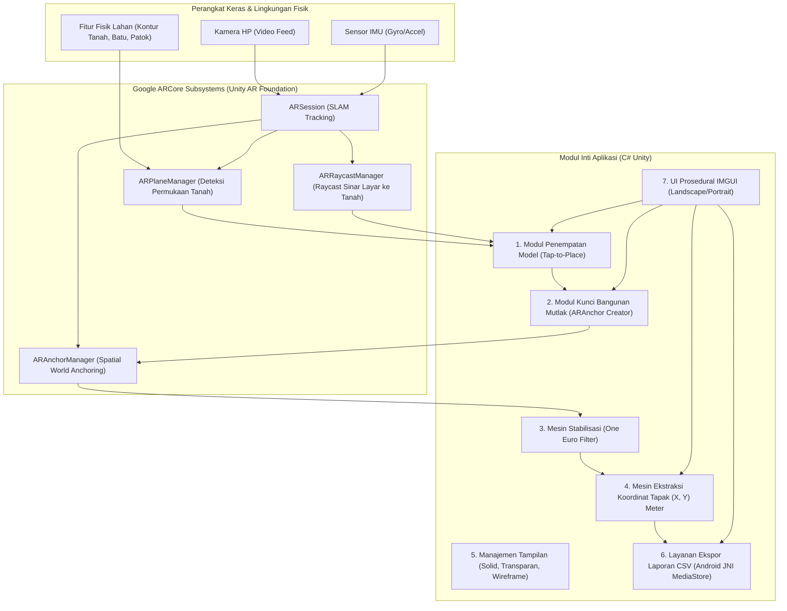

# Software Requirements Specification (SRS)
## Proyek: AR-SitePlan - Sistem Proyeksi Desain Bangunan & Penguncian Spasial Lahan AR

---

## 1. Pendahuluan (Introduction)

### 1.1. Tujuan Dokumen (Purpose)
Dokumen *Software Requirements Specification* (SRS) ini mendefinisikan arsitektur teknis, spesifikasi komponen perangkat lunak, dan daftar fitur sistem dari aplikasi **AR-SitePlan**. Fokus utama spesifikasi ini adalah kemampuan **memproyeksikan model 3D desain bangunan di atas permukaan lahan fisik**, **mengunci posisi bangunan secara mutlak menggunakan Spatial World Anchor (sehingga bangunan tidak bergeser saat kamera dialihkan)**, serta **mengekstrak titik koordinat $(X, Y)$ tapak batas lahan dalam satuan meter**.

### 1.2. Cakupan Produk (Scope)
Aplikasi ini beroperasi pada perangkat mobile Android yang memanfaatkan subsistem Google ARCore melalui Unity AR Foundation. Sistem menyediakan alur:
1. Pemindaian dan deteksi bidang permukaan tanah lahan (`ARPlaneManager`).
2. Penempatan model desain bangunan 3D di atas tanah melalui raycast sentuhan layar (`ARRaycastManager`).
3. Penguncian posisi dan orientasi absolut menggunakan penambatan spasial dunia (`ARAnchorManager`).
4. Stabilisasi getaran visual model berskala besar menggunakan *One Euro Filter*.
5. Kalkulasi dan ekstraksi koordinat kartesian 2D $(X_i, Y_i)$ titik sudut pondasi/tapak bangunan dalam satuan meter.
6. Penyimpanan laporan koordinat ke format CSV standar via Android MediaStore JNI API.

### 1.3. Definisi & Istilah Teknis
* **Spatial World Anchor (`ARAnchor`)**: Titik referensi spasial di dunia nyata yang dilacak terus-menerus oleh ARCore menggunakan kumpulan titik fitur lingkungan (*environmental feature points*). Jika objek di-parent ke `ARAnchor`, objek akan tetap berada di koordinat fisik tersebut meski kamera berpaling atau bergerak ke tempat lain.
* **Ground Plane Detection**: Algoritma ARCore untuk mengidentifikasi permukaan horizontal datar (tanah, rumput, aspal, beton) sebagai bidang tapak pondasi.
* **Raycast-to-Plane**: Penembakan sinar matematis dari titik sentuh 2D layar ponsel ke permukaan 3D tanah dunia nyata.
* **Coordinate Extraction**: Transformasi posisi vertex 3D sudut bangunan relatif terhadap titik patok awal menjadi koordinat kartesian 2D $(X, Y)$ dalam satuan meter (m).

---

## 2. Arsitektur Teknis Sistem (System Architecture)



---

## 3. Daftar Fitur Lengkap Sistem (System Features Specification)

```text
===================================================================================================
DAFTAR FITUR LENGKAP SISTEM AR-SITEPLAN
===================================================================================================
[FITUR-01] Deteksi Bidang Permukaan Tanah Lahan (Ground Plane Detection)
[FITUR-02] Penempatan Model Desain Bangunan 3D Berbasis Sentuhan (Tap-to-Place Raycast)
[FITUR-03] Penguncian Spasial Mutlak (Spatial World Anchor Lock via ARAnchorManager)
[FITUR-04] Kestabilan Posisi Lahan saat Kamera Dialihkan 360° (Persistent Non-Drift Tracking)
[FITUR-05] Mesin Stabilisasi Skala Besar (Adaptive One Euro Filter)
[FITUR-06] Ekstraksi Koordinat Tapak Bangunan (X, Y) dalam Satuan Meter
[FITUR-07] Penentuan Patok Referensi Titik Nol Lahan (Site Origin Benchmark)
[FITUR-08] Label Visual Koordinat Mengambang Real-Time (Floating Billboard Coordinate Labels)
[FITUR-09] Skalabilitas Fleksibel: Skala Nyata 1:1 dan Skala Pratinjau Maket (1:10 s.d. 1:100)
[FITUR-10] Rotasi Orientasi Bangunan (Yaw Rotation 0° s.d. 360°)
[FITUR-11] Manajemen Material Visual: Solid, Transparan (X-Ray Kontur), dan Wireframe
[FITUR-12] Perhitungan Jarak Antar Patok & Keliling Tapak Bangunan (Perimeter & Distance Gauge)
[FITUR-13] Ekspor Laporan Data Lapangan ke Format CSV Standar (Android MediaStore JNI)
[FITUR-14] Dokumentasi Foto Bersih Berparameter Metadata (Clean Site Photo Capture)
[FITUR-15] Antarmuka Khusus Lapangan Tanpa Canvas (Procedural High-Visibility IMGUI)
===================================================================================================
```

---

### [FITUR-01] Deteksi Bidang Permukaan Tanah Lahan (*Ground Plane Detection*)
* **Deskripsi:** Mendeteksi permukaan datar tanah, rumput, aspal, atau paving block secara *real-time*.
* **Komponen:** `ARPlaneManager`, `ARPlaneMeshVisualizer`.
* **Kriteria Teknis:**
  * Memfilter hanya bidang horizontal yang menghadap ke atas (`PlaneAlignment.HorizontalUp`).
  * Menggambar visualisasi kisi-kisi tanah transparan saat mencari bidang, dan menyembunyikannya setelah bangunan diletakkan.

---

### [FITUR-02] Penempatan Model Desain Bangunan 3D (*Tap-to-Place Raycast*)
* **Deskripsi:** Menempatkan rancangan bangunan 3D di atas permukaan tanah fisik berdasarkan ketukan jari di layar.
* **Komponen:** `ARRaycastManager`, prefab model bangunan.
* **Alur Pemrosesan:**
  1. Pengguna mengetuk layar pada koordinat piksel $(px, py)$.
  2. Sistem menembakkan sinar raycast:
     ```csharp
     List<ARRaycastHit> hits = new List<ARRaycastHit>();
     raycastManager.Raycast(touchPosition, hits, TrackableType.PlaneWithinPolygon);
     ```
  3. Jika terdeteksi perpotongan dengan bidang tanah, model bangunan diposisikan tepat pada pose `hits[0].pose`.

---

### [FITUR-03] Penguncian Spasial Mutlak (*Spatial World Anchor Lock*)
* **Deskripsi:** Menambatkan transformasi posisi dan rotasi bangunan secara permanen ke koordinat fisik dunia nyata.
* **Komponen:** `ARAnchorManager`, `ARAnchor`.
* **Logika Eksekusi:**
  1. Saat tombol **"KUNCI BANGUNAN"** ditekan:
  2. Sistem membuat `ARAnchor` baru pada pose tanah yang dipilih:
     ```csharp
     ARAnchor anchor = anchorManager.AddAnchor(buildingInstance.transform.position, buildingInstance.transform.rotation);
     buildingInstance.transform.SetParent(anchor.transform, true);
     ```
  3. Status sistem beralih ke mode `LOCKED`.

---

### [FITUR-04] Kestabilan Posisi Saat Kamera Dialihkan (*Persistent Non-Drift Tracking*)
* **Deskripsi:** Menjamin bahwa ketika kamera ponsel dialihkan ke arah lain, bangunan tetap berada di tempatnya dan tidak berpindah saat kamera kembali diarahkan ke lokasi semula.
* **Kriteria Penerimaan (Acceptance Criteria):**
  * Pengguna dapat menolehkan kamera 180° membelakangi lokasi bangunan, mengarahkan kamera ke langit, atau berjalan 20 meter mengelilingi lahan.
  * Ketika kamera diarahkan kembali ke tanah lokasi proyek: **Model bangunan 3D tampil persis di koordinat tanah semula** tanpa pergeseran (*drift* toleransi $\le 5\text{ cm}$).

---

### [FITUR-05] Mesin Stabilisasi Skala Besar (*One Euro Filter*)
* **Deskripsi:** Meredam getaran visual (*jitter*) pada bangunan berukuran besar ($10\text{ m} \times 20\text{ m}$) agar dinding dan atap tidak berosilasi di layar.
* **Komponen:** Class `PoseFilter` (One Euro Filter adaptif).
* **Formula:**
  $$f_c = f_{c,\min} + \beta \|\dot{x}\|, \quad \alpha = \frac{1}{1 + \frac{1}{2\pi f_c \Delta t}}$$
* Menggabungkan posisi terfilter secara halus saat ponsel digerakkan oleh tangan pengguna di lapangan.

---

### [FITUR-06] Ekstraksi Koordinat Tapak Bangunan $(X, Y)$ dalam Satuan Meter
* **Deskripsi:** Menghitung koordinat 2D nyata dari setiap titik sudut batas bangunan di atas permukaan lahan.
* **Logika Perhitungan:**
  1. Mengambil posisi 3D di dunia nyata dari masing-masing sudut tapak pondasi bangunan ($P_0, P_1, P_2, \dots, P_n$).
  2. Titik $P_0$ (sudut acuan awal) ditetapkan sebagai **Titik Nol $(0.00, 0.00)\text{ m}$**.
  3. Koordinat titik sudut ke-$i$ dihitung terhadap sumbu lokal lahan:
     $$X_i = (P_{i, x} - P_{0, x}), \quad Y_i = (P_{i, z} - P_{0, z})$$
  4. Output presisi tinggi: angka desimal float 2 angka di belakang koma (akurasi centimeter).

---

### [FITUR-07] Penentuan Patok Referensi Titik Nol Lahan (*Site Benchmark*)
* **Deskripsi:** Pengguna dapat memilih sudut mana dari tapak bangunan yang dijadikan acuan titik nol $(0, 0)$.
* **Pilihan Acuan:**
  * Sudut Kiri-Bawah (Depan-Kiri).
  * Sudut Kiri-Atas (Belakang-Kiri).
  * Sudut Kanan-Bawah (Depan-Kanan).
  * Sudut Pusat Tapak (Tengah Lahan).

---

### [FITUR-08] Label Visual Koordinat Mengambang (*Floating Billboard Labels*)
* **Deskripsi:** Menampilkan label koordinat teks melayang di atas setiap titik patok di layar AR.
* **Format Teks Label:**
  ```text
  [Patok 1] X: 0.00 m | Y: 0.00 m
  [Patok 2] X: 8.50 m | Y: 0.00 m (Jarak: 8.50 m)
  [Patok 3] X: 8.50 m | Y: 12.00 m (Jarak: 14.71 m)
  [Patok 4] X: 0.00 m | Y: 12.00 m (Jarak: 12.00 m)
  ```
* Label secara otomatis menghadap ke arah kamera pengguna (*Billboard Transform*).

---

### [FITUR-09] Skalabilitas Fleksibel: Skala Nyata 1:1 dan Skala Maket
* **Deskripsi:** Mengubah skala model bangunan sesuai kebutuhan peninjauan lapangan.
* **Mode Skala:**
  * **Skala 1:1 (Real-Life Scale)**: Ukuran sesungguhnya di lapangan ($1\text{ unit Unity} = 1\text{ meter fisik}$).
  * **Skala Maket (1:10, 1:20, 1:50, 1:100)**: Mengecilkan bangunan menjadi seukuran meja untuk pratinjau keseluruhan tapak jika lahan terlalu luas untuk dijelajahi dengan berjalan kaki.

---

### [FITUR-10] Rotasi Orientasi Bangunan (Yaw Rotation 0° s.d. 360°)
* **Deskripsi:** Menyelaraskan arah hadap fasad bangunan virtual dengan jalan raya atau kompas lahan fisik.
* **Kontrol:** Slider rotasi kontinu 0°–360° dan tombol putar cepat per 90°.

---

### [FITUR-11] Manajemen Material Visual (Solid, Transparan, Wireframe)
* **Deskripsi:** Mengatur tampilan model untuk memeriksa relasi rancangan dengan permukaan tanah asli:
  * **Solid**: Dinding, atap, pintu, dan jendela dengan tekstur penuh.
  * **Transparan (X-Ray)**: Dinding transparan (opasitas 30%–50%) untuk melihat kontur tanah asli di bawah lantai bangunan.
  * **Wireframe**: Garis denah tapak pondasi untuk memudahkan penancapan patok kayu fisik oleh pekerja lapangan.

---

### [FITUR-12] Perhitungan Jarak Antar Patok & Keliling Tapak Lahan
* **Deskripsi:** Menghitung jarak garis lurus antar sudut tapak pondasi secara otomatis:
  $$D_{1-2} = \sqrt{(X_2 - X_1)^2 + (Y_2 - Y_1)^2}$$
  Serta total keliling (*perimeter*) tapak pondasi dalam meter.

---

### [FITUR-13] Ekspor Laporan Data Lapangan ke Format CSV Standar
* **Deskripsi:** Menyimpan rekap data koordinat titik sudut tapak bangunan langsung ke penyimpanan HP.
* **Integrasi Native Android (JNI MediaStore):**
  * Disimpan di folder publik perangkat: `Download/ARAkurasi/Site_Koordinat_[Timestamp].csv`.
  * Encoding UTF-8 dengan BOM (Byte Order Mark) agar rapi dibuka di Microsoft Excel.

---

### [FITUR-14] Dokumentasi Foto Bersih Berparameter Metadata
* **Deskripsi:** Memotret tampilan AR tanpa tombol UI yang menghalangi.
* **Format Nama File Gambar:**
  ```text
  Site_Bangunan_Skala1-1_KunciSpasial_H160cm_20261113_110000.png
  ```
* Disimpan otomatis ke galeri Android: `Pictures/ARAkurasi/`.

---

### [FITUR-15] Antarmuka Khusus Lapangan Tanpa Canvas (IMGUI High-Visibility)
* **Deskripsi:** Seluruh antarmuka digambar menggunakan Unity IMGUI dengan teks berkontras tinggi agar terbaca jelas di bawah terik sinar matahari luar ruangan (*outdoor daylight*).

---

## 4. Antarmuka Eksternal & Integrasi Native (External Interfaces)

### 4.1. Integrasi Android MediaStore JNI
Data CSV disimpan menggunakan API Android modern tanpa izin berbahaya (*Scoped Storage*):
```csharp
using (var player = new AndroidJavaClass("com.unity3d.player.UnityPlayer"))
using (var activity = player.GetStatic<AndroidJavaObject>("currentActivity"))
using (var resolver = activity.Call<AndroidJavaObject>("getContentResolver"))
using (var values = new AndroidJavaObject("android.content.ContentValues"))
using (var media = new AndroidJavaClass("android.provider.MediaStore$Downloads"))
{
    values.Call("put", "_display_name", fileName);
    values.Call("put", "mime_type", "text/csv");
    values.Call("put", "relative_path", "Download/ARAkurasi");
    // Write stream data...
}
```

---

## 5. Kamus Data & Skema CSV Koordinat Lapangan

Format baris data pada file CSV yang dihasilkan:

| Kolom | Tipe | Contoh Nilai | Keterangan |
|---|---|---|---|
| `timestamp` | String | `2026-11-13 10:45:00` | Waktu pencatatan data di lapangan |
| `nama_bangunan` | String | `Desain Rumah Tipe 36` | Nama prefab/proyek model 3D |
| `skala` | String | `1:1` | Skala proyeksi visual |
| `titik_ke` | Integer | `1` | Nomor indeks patok sudut tapak |
| `nama_patok` | String | `Sudut Depan-Kiri (Nol)` | Identifikasi sudut bangunan |
| `x_meter` | Float | `0.00` | Koordinat X tapak relatif terhadap titik acuan |
| `y_meter` | Float | `0.00` | Koordinat Y tapak relatif terhadap titik acuan |
| `jarak_dari_nol_m` | Float | `0.00` | Jarak Euclidean dari patok acuan awal |
| `status_kunci` | String | `Terkunci (ARAnchor)` | Konfirmasi status spatial anchoring |

---

## 6. Matriks Ketertelusuran Fitur (Traceability Matrix)

| ID Fitur | Komponen Unity / Class | Fungsi / Metode Utama | Status |
|---|---|---|---|
| `FITUR-01` | `ARPlaneManager` | `trackablesChanged`, `PlaneAlignment.HorizontalUp` | ✅ Siap Dikonfigurasi |
| `FITUR-02` | `ARRaycastManager` | `Raycast(touchPos, hits, TrackableType.PlaneWithinPolygon)` | ✅ Siap Dikonfigurasi |
| `FITUR-03` | `ARAnchorManager` | `AddAnchor(pose)`, `transform.SetParent()` | ✅ Siap Diintegrasikan |
| `FITUR-04` | `ARAnchor` SLAM | Environmental Feature Point Retentive Tracking | ✅ Otomatis via ARCore |
| `FITUR-05` | `PoseFilter` | `OneEuroFilter.Apply()` | ✅ Tersedia di Kode |
| `FITUR-06` | Geometri Mesh Tapak | `ExtractFootprintCorners()`, `LocalToMeters()` | ✅ Siap Disesuaikan |
| `FITUR-07` | Transform Pivot | `SetSiteOriginBenchmark()` | ✅ Tersedia di Kode |
| `FITUR-08` | IMGUI Billboard | `DrawFloatingCoordinateLabels()` | ✅ Tersedia di Kode |
| `FITUR-09` | Transform LocalScale | `ApplyScale(denominator)` | ✅ Tersedia di Kode |
| `FITUR-10` | Transform Rotation | `SetYawRotation(angle)` | ✅ Tersedia di Kode |
| `FITUR-11` | Material Shader Overlay | `ApplyLook(LookMode)` | ✅ Tersedia di Kode |
| `FITUR-12` | Matematika Euclidean | `Vector2.Distance(ptA, ptB)` | ✅ Tersedia di Kode |
| `FITUR-13` | Android JNI MediaStore | `SaveToDownloadsAndroid(csvData)` | ✅ Tersedia di Kode |
| `FITUR-14` | ScreenCapture | `CaptureScreenshotAsTexture()`, `SaveToGalleryAndroid()` | ✅ Tersedia di Kode |
| `FITUR-15` | IMGUI Runtime | `OnGUI()`, `DrawLandscapeControls()` | ✅ Tersedia di Kode |
