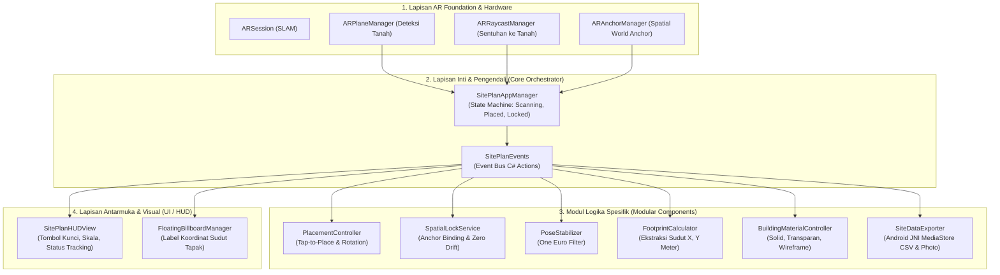
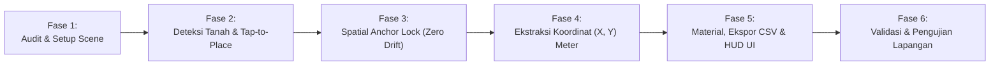

# Blueprint & Implementation Plan: AR-SitePlan

> **Dokumen Acuan Rekayasa Ulang (*Re-engineering & Refactoring Blueprint*)**  
> **Proyek Target:** `AR-SitePlan` (D:\Kuliah UNDIP\Project\AR-SitePlan)  
> **Basis Referensi:** `ARCORE 2` (D:\Kuliah UNDIP\Project\ARCORE 2) — *Read-Only / No Modification*  
> **Versi Dokumen:** 1.0.0  
> **Tanggal Penyusunan:** 13 November 2026  
> **Target Platform:** Android ARM64 (Google ARCore, Min SDK API 24, Unity 6 / URP 17.x)

---

## 1. Eksekutif & Latar Belakang Perubahan (*The Paradigm Shift*)

### 1.1. Kondisi Proyek Lama (`ARCORE 2`) & Masalah *Bloated Code*
Proyek pendahulu (`ARCORE 2`) memiliki fungsionalitas pengujian AR yang kaya, namun menderita masalah arsitektur serius:
1. **Monolithic God-Class Anti-Pattern**: File [`ScalableImageAR.cs`](file:///d:/Kuliah%20UNDIP/Project/ARCORE%202/Assets/Scripts/ScalableImageAR.cs) membengkak hingga **4.300+ baris kode** dalam satu kelas tunggal. File ini mencampuradukkan:
   * Siklus hidup AR dan event pelacakan.
   * Algoritma stabilisasi (One Euro Filter).
   * Perhitungan skala model dan titik pivot.
   * Telemetri kamera dan sliding-window jitter meter.
   * Penangkapan layar dan rutinitas penulisan metadata.
   * UI IMGUI prosedural sepanjang ribuan baris.
   * Integrasi JNI Android MediaStore untuk CSV dan galeri foto.
   * Pembekuan frame kamera (*freeze frame*) dan digital zoom 1x-16x.
   * Pengukuran manual tanda silang (*crosshair*).
   * Pipeline Computer Vision murni tanpa OpenCV (konversi luminansi, integral image, threshold adaptif, morfologi opening, BFS connected components).
   * Unproyeksi fotogrametri sinar kamera ke bidang marker.
   * Ekstraksi kontur batas mesh 3D.
2. **Keterikatan Marker Meja Lab (*Table-top Marker Dependency*)**: Bergantung pada penanda fisik kertas 10x10 cm (`marker_bw.png`).
3. **Tingkat Kerapuhan Tinggi (*Fragility & Technical Debt*)**: Mengubah satu komponen UI berisiko merusak logika raycast atau komputasi matriks karena variabel global dan dependensi yang saling tumpang tindih.

### 1.2. Visi & Tujuan Utama Proyek Baru (`AR-SitePlan`)
Proyek **`AR-SitePlan`** dibangun ulang dari nol (*clean slate*) untuk mewujudkan kebutuhan pengguna yang spesifik dan esensial:
> **Pernyataan Kebutuhan Pengguna:**  
> *"Aplikasi bisa memproyeksikan desain bangunan di sebuah lahan menggunakan kamera, kemudian dapat mengunci bangunannya, kemudian bisa mendapatkan titik (X, Y)-nya. Ketika kamera dialihkan ke bagian lain maka bangunan yang sudah dikunci akan tetap berada di tempatnya tanpa pindah tempat."*

### 1.3. Aturan Ketat Proyek (*Core Constraints*)
* ⛔ **DILARANG MENGUBAH PROYEK `ARCORE 2`**: Direktori `D:\Kuliah UNDIP\Project\ARCORE 2` adalah artefak referensi murni (*read-only*).
* ✅ **FOKUS KERJA PENUH PADA `AR-SitePlan`**: Seluruh script baru, scene, prefab, dan dokumentasi ditempatkan di `D:\Kuliah UNDIP\Project\AR-SitePlan`.
* 💎 **CLEAN CODE & MODULAR**: Menggunakan prinsip *Single Responsibility Principle* (SRP), *Separation of Concerns* (SoC), dan arsitektur berbasis event/komponen. Setiap file C# dibatasi hanya mengelola satu domain tanggung jawab (target 80–250 baris per file).

---

## 2. Analisis Perbandingan: Kode Warisan vs Kode Bersih Baru

| Aspek Arsitektur | Proyek Warisan (`ARCORE 2`) | Proyek Baru (`AR-SitePlan`) | Alasan & Manfaat |
|---|---|---|---|
| **Struktur Kelas** | 1 Monolit raksasa (`ScalableImageAR.cs` > 4300 baris) | 8–10 Kelas Modular Terpisah (masing-masing < 250 baris) | Modularitas tinggi, mudah dibaca, mudah diuji unit test, zero bloat. |
| **Metode Pelacakan AR** | `ARTrackedImageManager` (Marker Kertas 10x10 cm) | `ARPlaneManager` + `ARRaycastManager` + `ARAnchorManager` | Sesuai skala lahan terbuka (*real-world ground plane*). |
| **Penguncian Posisi Objek** | Kunci pose relatif terhadap penanda gambar | **Spatial World Anchor (`ARAnchor`)** | **Zero Drift**: Bangunan tidak bergeser saat kamera dialihkan 360° atau ditengadahkan ke langit. |
| **Satuan Koordinat** | Milimeter (mm) di atas bidang kertas meja | **Meter (m)** di atas lahan tanah fisik | Standar surveyor dan teknik sipil lapangan. |
| **Computer Vision Kustom** | Integral image, BFS blob matching (ratusan baris) | **DIBUANG (Eliminasi Total)** | Fitur deteksi tinta marker tidak lagi relevan untuk lahan terbuka. Memangkas bloat secara signifikan. |
| **Freeze Frame & Zooming** | Pengambilan tekstur CPU2D & UI zoom manual | **DIBUANG (Eliminasi Total)** | Pengguna berinteraksi langsung secara *live-AR* di lapangan. |
| **Manajemen UI** | Ribuan baris IMGUI prosedural tercampur di logic loop | Script UI Controller terpisah (Event-Driven) | Logika komputasi AR bersih dari kode tampilan antarmuka. |

---

## 3. Arsitektur Perangkat Lunak Bersih (*Clean Architecture Blueprint*)



### 3.1. Struktur Direktori Kode Bersih (`Assets/Scripts/`)
Untuk memastikan kode tidak lagi membengkak (*unbloated*), struktur folder skrip di `AR-SitePlan` ditata sebagai berikut:

```text
Assets/Scripts/
├── Core/
│   ├── SitePlanAppManager.cs       # State machine aplikasi (Scanning -> Placed -> Locked)
│   └── SitePlanEvents.cs           # Event bus / delegate decoupling antar modul
├── AR/
│   ├── GroundPlaneDetector.cs      # Mengelola visualisasi & siklus bidang tanah
│   ├── PlacementController.cs      # Raycast sentuhan layar (Tap-to-Place) & kontrol rotasi yaw
│   └── SpatialLockService.cs       # Penambatan ARAnchor mutlak (Zero Drift saat kamera menoleh)
├── Stabilization/
│   ├── OneEuroFilter.cs            # Algoritma matematika peredam jitter posisi & rotasi
│   └── PoseStabilizer.cs           # Komponen penstabil transformasi model bangunan
├── Coordinates/
│   ├── FootprintCalculator.cs      # Ekstraksi koordinat (X, Y) tapak pondasi dalam meter
│   ├── SiteBenchmark.cs            # Definisi patok titik nol (0.00, 0.00) m
│   └── CoordinatePoint.cs          # Struktur data sudut tapak lahan
├── Visualization/
│   ├── BuildingMaterialController.cs # Pengatur material (Solid, Transparan X-Ray, Wireframe)
│   └── FloatingBillboard.cs        # Komponen teks koordinat menghadap ke arah kamera
├── Export/
│   ├── AndroidMediaStoreBridge.cs  # Panggilan native Android JNI untuk simpan tanpa izin bahaya
│   ├── CsvReportExporter.cs        # Format ekspor data tabel koordinat lahan
│   └── SiteScreenshotCapture.cs    # Pengambilan foto bersih (clean capture) tanpa elemen UI
└── UI/
    └── SitePlanHUDController.cs    # Tampilan UI lapangan (tombol kunci, slider skala, status)
```

---

## 4. Daur Ulang Logika Inti dari `ARCORE 2` (*Refactored Assets & Math*)

Berikut adalah logika matematika dan komponen dari `ARCORE 2` yang **didaur ulang dan direfaktor menjadi bersih**:

### 4.1. Algoritma One Euro Filter (Stabilisasi Getaran Sensor)
* **Sumber Asal:** [`ScalableImageAR.cs` Baris 470–509](file:///d:/Kuliah%20UNDIP/Project/ARCORE%202/Assets/Scripts/ScalableImageAR.cs#L470).
* **Bentuk Bersih Baru:** Diekstrak menjadi kelas murni C# [`OneEuroFilter.cs`](#) tanpa dependensi engine monolitik.
* **Rumus Matematis:**
  $$\hat{x}_k = \alpha x_k + (1 - \alpha) \hat{x}_{k-1}$$
  $$f_c = f_{c,\min} + \beta \|\dot{x}_k\|, \quad \alpha = \frac{1}{1 + \frac{1}{2\pi f_c \Delta t}}$$
* **Manfaat di `AR-SitePlan`**: Menjaga model bangunan berskala besar ($10\text{ m} \times 20\text{ m}$) tetap kokoh dan stabil di mata kamera tanpa osilasi mikro (*jittering*).

### 4.2. Penambatan Spasial Mutlak (*Spatial World Anchor Lock*)
* **Sumber Referensi:** Konsep penambatan pose pada `ARCORE 2` ([`konteks.md`](file:///d:/Kuliah%20UNDIP/Project/ARCORE%202/konteks.md)).
* **Bentuk Bersih Baru:** [`SpatialLockService.cs`](#).
* **Mekanisme Kerja Inti:**
  ```csharp
  // Saat pengguna menekan "Kunci Bangunan":
  Pose currentPose = new Pose(buildingTransform.position, buildingTransform.rotation);
  ARAnchor anchor = anchorManager.AddAnchor(currentPose);
  buildingTransform.SetParent(anchor.transform, true);
  isLocked = true;
  ```
* **Jaminan Non-Drift:** Begitu diikat ke `ARAnchor`, Google ARCore terus memelihara relasi spasial objek terhadap *feature points* fisik lingkungan sekitar. Kamera bebas berputar 360°, menghadap tanah lain, atau menengadah ke langit; saat kembali menghadap lokasi patok, **bangunan tetap berada di posisi koordinat fisiknya**.

### 4.3. Ekstraksi Koordinat $(X, Y)$ Tapak Sudut Bangunan
* **Sumber Asal:** [`ScalableImageAR.cs` Baris 864–988](file:///d:/Kuliah%20UNDIP/Project/ARCORE%202/Assets/Scripts/ScalableImageAR.cs#L864).
* **Bentuk Bersih Baru:** [`FootprintCalculator.cs`](#).
* **Mekanisme Kerja Inti:**
  1. Membaca titik-titik sudut terluar dari *Bounding Box* atau vertex tapak terbawah ($Y \approx 0$) dari mesh model bangunan.
  2. Titik patok pertama (misal: sudut Barat Daya / kiri-bawah) ditetapkan sebagai **Titik Patok Nol $(0.00, 0.00)\text{ m}$**.
  3. Sudut-sudut berikutnya dikonversi relatif terhadap titik nol dalam satuan meter:
     $$X_i = P_{i, x} - P_{0, x}, \quad Y_i = P_{i, z} - P_{0, z}$$
  4. Menghasilkan output tabel koordinat dan jarak perimeter antar patok.

### 4.4. Layanan Ekspor MediaStore Android (JNI)
* **Sumber Asal:** [`ScalableImageAR.cs` Baris 2060–2130](file:///d:/Kuliah%20UNDIP/Project/ARCORE%202/Assets/Scripts/ScalableImageAR.cs#L2060).
* **Bentuk Bersih Baru:** [`AndroidMediaStoreBridge.cs`](#).
* **Keunggulan:** Menggunakan Android JNI `MediaStore.Downloads` dan `MediaStore.Images` sehingga aplikasi dapat langsung menulis laporan CSV ke folder publik `Download/ARAkurasi/` dan foto dokumentasi ke `Pictures/ARAkurasi/` pada Android 10, 11, 12, 13, 14+ tanpa memerlukan izin runtime berbahaya (*Scoped Storage Compliant*).

---

## 5. Rencana Aksi Bertahap (*Step-by-Step Implementation Roadmap*)



### Fase 1: Persiapan Environment & Konfigurasi Scene AR-SitePlan
1. **Verifikasi Package Manager (`Packages/manifest.json`)**:
   * Memastikan dependensi resmi terpasang:
     * `com.unity.xr.arfoundation` (6.x)
     * `com.unity.xr.arcore` (6.x)
     * `com.unity.render-pipelines.universal` (17.x)
     * `com.unity.inputsystem`
2. **Setup Scene Utama (`Assets/Scenes/SiteScene.unity`)**:
   * Membuat GameObject `XR Origin (AR Rig)` dengan konfigurasi:
     * `AR Plane Manager`: Deteksi bidang datar horizontal (`Horizontal Up`).
     * `AR Raycast Manager`: Deteksi ketukan jari di atas bidang tanah.
     * `AR Anchor Manager`: Penambatan spasial dunia nyata.
     * `AR Input Manager`: Interaksi layar sentuh mobile modern.
   * Membuat GameObject `AR Session` untuk siklus hidup pelacakan ARCore.
   * Konfigurasi pencahayaan outdoor (*Directional Light* dan URP Volume).

### Fase 2: Implementasi Modul Penempatan (*Ground Detection & Tap-to-Place*)
1. Menulis script [`GroundPlaneDetector.cs`](file:///d:/Kuliah%20UNDIP/Project/AR-SitePlan/Assets/Scripts/AR/GroundPlaneDetector.cs):
   * Mengatur visualizer kisi-kisi tanah saat proses pemindaian.
   * Menonaktifkan visualizer kisi setelah bangunan berhasil diletakkan agar tampilan visual bersih.
2. Menulis script [`PlacementController.cs`](file:///d:/Kuliah%20UNDIP/Project/AR-SitePlan/Assets/Scripts/AR/PlacementController.cs):
   * Menembakkan *Raycast* saat pengguna mengetuk layar (`TouchPhase.Began`).
   * Menempatkan model desain bangunan tepat di atas permukaan tanah fisik.
   * Memberikan kontrol slider rotasi hadap (Yaw 0°–360°).

### Fase 3: Implementasi Penguncian Spasial Mutlak (*Spatial Anchor Lock*)
1. Menulis script [`SpatialLockService.cs`](file:///d:/Kuliah%20UNDIP/Project/AR-SitePlan/Assets/Scripts/AR/SpatialLockService.cs):
   * Membuat `ARAnchor` pada posisi tanah saat ini ketika tombol "Kunci Bangunan" ditekan.
   * Menjadikan transform bangunan sebagai *child* dari anchor tersebut.
   * Mengintegrasikan [`OneEuroFilter.cs`](file:///d:/Kuliah%20UNDIP/Project/AR-SitePlan/Assets/Scripts/Stabilization/OneEuroFilter.cs) untuk meredam jitter visual.
2. **Validasi Kritis Non-Drift**:
   * Menguji pembalikan arah kamera ponsel 180° dan 360°: Memastikan model bangunan tetap kokoh di tempatnya saat kamera kembali menghadap ke lokasi lahan.

### Fase 4: Implementasi Ekstraksi Koordinat $(X, Y)$ Tapak Bangunan
1. Menulis script [`FootprintCalculator.cs`](file:///d:/Kuliah%20UNDIP/Project/AR-SitePlan/Assets/Scripts/Coordinates/FootprintCalculator.cs):
   * Mengekstrak 4 sudut tapak pondasi bangunan (P1, P2, P3, P4).
   * Menghitung nilai koordinat kartesian 2D $(X_i, Y_i)$ dalam meter terhadap patok titik nol.
   * Menghitung panjang bentang sisi dinding (misal $P_1 \to P_2 = 12.00\text{ m}$, $P_2 \to P_3 = 8.50\text{ m}$) dan total keliling/luas tapak.
2. Menulis script [`FloatingBillboard.cs`](file:///d:/Kuliah%20UNDIP/Project/AR-SitePlan/Assets/Scripts/Visualization/FloatingBillboard.cs):
   * Memunculkan label teks mengambang di atas setiap sudut bangunan yang selalu menghadap kamera pengguna secara *real-time*.

### Fase 5: Implementasi Manajemen Material, Ekspor Data, & Antarmuka UI
1. Menulis script [`BuildingMaterialController.cs`](file:///d:/Kuliah%20UNDIP/Project/AR-SitePlan/Assets/Scripts/Visualization/BuildingMaterialController.cs):
   * Mode Solid: Dinding dan atap bangunan terlihat realistis.
   * Mode Transparan / X-Ray: Opasitas 30% untuk menginspeksi kontur tanah di dalam bangunan.
   * Mode Wireframe: Menampilkan garis rangka tapak pondasi.
2. Menulis script [`AndroidMediaStoreBridge.cs`](file:///d:/Kuliah%20UNDIP/Project/AR-SitePlan/Assets/Scripts/Export/AndroidMediaStoreBridge.cs) & [`CsvReportExporter.cs`](file:///d:/Kuliah%20UNDIP/Project/AR-SitePlan/Assets/Scripts/Export/CsvReportExporter.cs):
   * Mengekspor tabel patok koordinat ke file CSV di `Download/ARAkurasi/`.
   * Mengambil tangkapan layar bersih beresolusi tinggi tanpa elemen UI ke `Pictures/ARAkurasi/`.
3. Menulis script [`SitePlanHUDController.cs`](file:///d:/Kuliah%20UNDIP/Project/AR-SitePlan/Assets/Scripts/UI/SitePlanHUDController.cs):
   * Antarmuka pengguna lapangan yang kontras, minimalis, dan mudah ditekan di bawah terik matahari.

### Fase 6: Validasi Lapangan & Verifikasi Build APK
1. Konfigurasi Player Settings Android:
   * Package Name: `com.undip.arsiteplan`
   * Target Architecture: **ARM64**
   * Scripting Backend: **IL2CPP**
   * Minimum API Level: **Android 7.0 (API 24)**
2. Build APK dan uji coba di ponsel fisik pada lahan terbuka.

---

## 6. Format Data Ekspor Standar Lapangan (*CSV Data Schema*)

File CSV yang dihasilkan oleh [`CsvReportExporter.cs`](#) dirancang agar kompatibel dengan software CAD (AutoCAD, Civil 3D) dan Microsoft Excel:

```csv
# LAPORAN PENGUKURAN KOORDINAT TAPAK BANGUNAN AR-SITEPLAN
# Tanggal: 2026-11-13 14:00:00
# Nama Model: Desain_Gedung_A.fbx
# Skala Terpasang: 1:1 (Real Scale)
# Status Penambatan: ARAnchor Spatial Locked (Zero Drift Confirmed)
# Patok Titik Nol (Benchmark): Sudut Kiri-Bawah (P1)

Nomor Patok,Label Sudut,Koordinat X (m),Koordinat Y (m),Elevasi Z (m),Jarak ke Patok Berikutnya (m)
P1,Sudut Kiri-Bawah (Origin),0.000,0.000,0.000,12.500
P2,Sudut Kanan-Bawah,12.500,0.000,0.002,20.000
P3,Sudut Kanan-Atas,12.500,20.000,-0.005,12.500
P4,Sudut Kiri-Atas,0.000,20.000,-0.003,20.000

# RINGKASAN DATA LAPANGAN
# Total Titik Patok: 4
# Keliling Tapak (Perimeter): 65.000 meter
# Estimasi Luas Tapak: 250.000 meter persegi
```

---

## 7. Matriks Pengujian & Kriteria Penerimaan (*Acceptance Matrix*)

| ID Uji | Skenario Pengujian | Hasil yang Diharapkan | Status Kelulusan |
|---|---|---|---|
| **TC-01** | Deteksi Permukaan Tanah di Luar Ruangan | Mesh bidang tanah horizontal muncul dalam waktu $\le 3$ detik setelah kamera diarahkan ke tanah. | WAJIB |
| **TC-02** | Ketukan Layar (*Tap-to-Place*) | Model 3D bangunan muncul tepat di atas titik tanah yang disentuh tanpa melayang atau tenggelam. | WAJIB |
| **TC-03** | **Penguncian Spasial (*Spatial Anchor*)** | Setelah menekan tombol "Kunci Bangunan", komponen `ARAnchor` terpasang secara aktif. | WAJIB |
| **TC-04** | **Uji Putar Kamera 360° (*Non-Drift Test*)** | Kamera diputar menjauhi bangunan 360° atau diarahkan ke langit. Saat diarahkan kembali ke tanah: **Bangunan tetap berada di koordinat fisiknya tanpa bergeser** (deviasi drift $\le 5\text{ cm}$). | **KRITIS / SYARAT MUTLAK** |
| **TC-05** | Ekstraksi Koordinat $(X, Y)$ | Koordinat sudut tapak pondasi ditampilkan dalam satuan meter dengan presisi 3 desimal $(0.000\text{ m})$. | WAJIB |
| **TC-06** | Ekspor CSV MediaStore JNI | File laporan CSV tersimpan di folder publik `Download/ARAkurasi/` dan dapat dibuka di Excel/WPS. | WAJIB |
| **TC-07** | Kebersihan Arsitektur Kode | Tidak ada kelas tunggal yang melebihi 300 baris kode. Seluruh modul terisolasi (*zero bloat*). | WAJIB |

---

## 8. Panduan Pengembang untuk Melanjutkan Eksekusi (*Next Steps*)

Bagi developer / agent yang mengeksekusi implementasi:
1. **Mulai dari Fase 1 & Fase 2**: Siapkan file-file C# modular di dalam direktori `Assets/Scripts/` proyek `AR-SitePlan` sesuai struktur hierarki di Bagian 3.1.
2. **Jangan menyalin seluruh kode lama**: Hanya ambil logika matematika yang relevan (One Euro Filter, rumus proyeksi, dan JNI Android MediaStore).
3. **Selalu verifikasi scene `SiteScene.unity`** agar komponen `ARSession`, `ARPlaneManager`, `ARRaycastManager`, dan `ARAnchorManager` terhubung secara benar.

